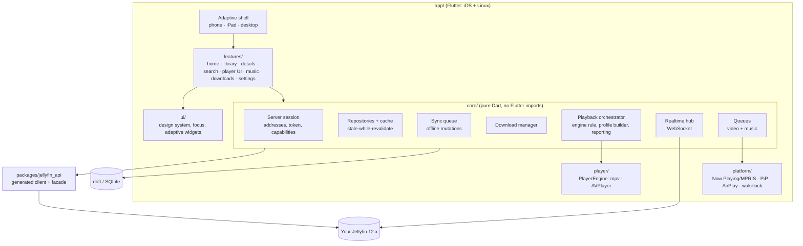

# Architecture

## Layers



Rules:

- **`core/` imports no Flutter.** A lint rule enforces this. Core logic unit-tests in milliseconds, and the download and sync work can run in isolates.
- **Generated API types never leave `jellyfin_api`.** Core maps them to our own models, so a spec change touches one package.
- **Features reach core only through Riverpod providers.**
- **Every native capability has a Dart interface with a Linux implementation or fake.** That's what lets iOS flows be developed on Linux (see [dev-workflow.md](dev-workflow.md#daily-loop-on-linux)).

## Repository layout

```
app/                         Flutter app; targets: ios, linux
  lib/core/                  models, repositories, sync, downloads, playback orchestration, queues
  lib/player/                PlayerEngine interface; mpv engine (media_kit, vendored); AVPlayer engine (plugin wrapper)
  lib/platform/              Now Playing/MPRIS, PiP, AirPlay, wakelock, PlatformInfo
  lib/ui/                    tokens, theming, adaptive layout, shared widgets
  lib/features/<feature>/    screens + view models
  lib/shell/                 navigation, routing, window chrome
  ios/  linux/
packages/
  jellyfin_api/              generated chopper client + JellyfinClient facade + ServerCapabilities (pure Dart)
tools/
  openapi/                   vendored spec + regenerate script + diff report
  census/                    library census CLI: what codecs, HDR types and subtitle formats your library contains
  fixtures/                  small FFmpeg-generated clips for engine smoke tests
.github/workflows/           linux.yml (every push), ios.yml (tags / manual)
justfile                     gen, check, run, census, ipa
docs/
```

## Server session

- **One server and one user in the UI.** The data model is keyed by server `Id` (from `/System/Info/Public`) and user id, so adding more later doesn't need a migration.
- **Several addresses per server**, which matters on the iPhone. For example: LAN `http://192.168.x.x:8096` at home, plus a public domain or a VPN/Tailscale address away from home.
  - On every network change (Wi-Fi ↔ cellular), probe the addresses in order with a short timeout and keep the first one that answers.
  - The current address shows in settings, with "LAN" or "remote" so the bitrate defaults can differ.
- **Auth:**
  - Every request carries `Authorization: MediaBrowser Client="jellymc", Device="<name>", DeviceId="<id>", Version="<ver>", Token="<token>"`.
  - URLs handed to players and the WebSocket carry `ApiKey=<token>`.
  - Never `X-Emby-Token`, `api_key`, or `/emby` routes, which 12.0 rejects.
  - Login is username/password (`/Users/AuthenticateByName`). The token goes into the Keychain on iOS and the Secret Service on Linux.
- **DeviceId:** a random id generated once per install. iPhone, iPad and Linux each appear as their own device in the server dashboard.
- **Reverse-proxy extras**, only if your setup needs them: base path (`https://host/jellyfin`), custom headers (for example Cloudflare Access), and trust for your own CA. On iOS, installing the CA as a profile works through NSURLSession. On Linux, use the system trust store or an in-app pin.
- **`ServerCapabilities`:** a single class for any version-conditional behaviour. On 12.x-only this stays small, but it keeps upgrades contained.

## Data: repositories, cache, sync

- **Cache model:**
  - `items`: id, type, parent and sort keys, plus the full DTO as JSON.
  - `query_results`: a normalized query key mapped to an ordered list of ids, plus the fetch time and total count.
  - `user_data`: played, position, favourite and rating.
- **Reads are stale-while-revalidate:** render from the cache instantly, refetch in the background, and diff the result in.
- **Lean requests:** per-screen `Fields=`, `EnableImageTypes`, `ImageTypeLimit`, and paging with `StartIndex`/`Limit`.
- **Realtime invalidation:** `LibraryChanged` evicts the affected queries. `UserDataChanged` patches played state and favourites live, so finishing an episode on Linux updates the iPhone immediately.
- **Offline mutation queue:** played/unplayed, favourites, ratings, playlist edits, and progress from offline playback. Entries carry client timestamps and replay in order on reconnect.
  - Offline progress goes to `POST /UserItems/{id}/UserData` (`PlaybackPositionTicks`, `LastPlayedDate`).
  - If the server's `LastPlayedDate` is newer, the server wins.
- **Roaming settings:** stored in server DisplayPreferences (`/DisplayPreferences/{id}?client=jellymc`, `CustomPrefs`). That covers the home layout, subtitle style, skip rules and language rules, so changes on Linux show up on the iPhone. Device-specific settings stay local: engine overrides, download quality, bitrate on cellular.

## Downloads (mainly the iPhone/iPad)

- **A job is one item plus a quality.** It expands into files:
  - the media
  - external subtitle streams and ASS font attachments
  - trickplay tiles at one width
  - images
  - JSON snapshots of chapters, media segments, lyrics and the item DTO

  Offline browsing and playback then need nothing from the server.
- **Original quality** comes from the static stream. **Transcoded quality** comes from a server transcode with explicit codec and bitrate limits.
  - Prefer an **HEVC/AAC MP4 or fMP4 output that AVPlayer can play**. Offline files then get PiP, HDR and battery-friendly playback, while mpv still handles any original-quality MKVs.
  - Spike S5 picks progressive download vs HLS segments.
- **iOS specifics:**
  - Background `URLSession` lets transfers continue when the app is suspended.
  - Files live in Application Support (excluded from iCloud backup), with a "show in Files app" option.
  - Wi-Fi-only and cellular toggles, and a storage cap.
- **Rules:**
  - Auto-download the next N unwatched episodes of chosen series.
  - Keep chosen playlists and albums synced.
  - Delete after watched, with a delay.
- Linux can download too. Files go under `$XDG_DATA_HOME/jellymc` or a chosen folder, which is mostly useful for laptops on trips.

## Realtime hub

- One WebSocket: `wss://<host>/socket?ApiKey=<token>&deviceId=<id>`.
  - Honour `ForceKeepAlive` by sending `KeepAlive` at half the interval.
  - Reconnect with jittered backoff.
  - On iOS, close it when the app is backgrounded and reopen it on resume.
- **Dispatch:**
  - `LibraryChanged` and `UserDataChanged` go to the cache.
  - `Play`, `Playstate` and `GeneralCommand` go to the remote-control handler, so jellyfin-web or another device can send media to the Linux app.
  - `SyncPlay*` goes to SyncPlay (M5).
  - `ServerRestarting` and `ServerShuttingDown` show a banner.
- Register as controllable with `POST /Sessions/Capabilities/Full`: playable media types, supported `GeneralCommandType`s, and `SupportsMediaControl`.

## Playback orchestrator

The orchestrator turns "play this" into a running engine and keeps the server informed. Full design in [playback.md](playback.md). It owns:

- `EngineRule`: Linux → mpv (in-app, or HDR window); iOS → AVPlayer when it can play the item without burn-in, else mpv.
- `DeviceProfileBuilder`: engine capabilities × device probes × settings → `DeviceProfile`.
- `PlaybackSession`: the `PlaybackInfo` call, URL building, track switching, the fallback chain, and progress reporting.
- `VideoQueue`: episodes, playlists, shuffle, and up next.

## Music pipeline

Music is a separate, queue-centric pipeline, not the video player in audio mode.

- **The queue lives in Dart:** original and shuffled order, repeat mode, "play next" vs "add to queue", and history. It's persisted, so the queue and position survive restarts and the 7-day re-sign.
- **Engines:** `just_audio` (AVQueuePlayer on iOS; mpv through `just_audio_media_kit` on Linux), giving gapless playback through playlist sources. `audio_service` provides lock screen, Control Center, Dynamic Island, AirPods and Bluetooth controls on iOS, and `audio_service_mpris` provides KDE's media applet and media keys on Linux.
- **Streaming:** `GET /Audio/{id}/universal` with a container list and `MaxStreamingBitrate`, using separate defaults for LAN, remote and cellular. Original files are used when allowed.
- **Normalization:** apply `NormalizationGain` (track mode) or `AlbumNormalizationGain` (album mode), with ramps to avoid clicks.
- **Lyrics:** `GET /Audio/{id}/Lyrics`. Lines have a `Start` in ticks and optional word-level `Cues`, which enables karaoke-style highlighting.

## Platform services

| Service | iOS / iPadOS | Linux (KDE Plasma, Wayland) |
|---|---|---|
| Now Playing / media controls | `audio_service`: MPNowPlayingInfoCenter + MPRemoteCommandCenter (lock screen, Dynamic Island, AirPods) | MPRIS over D-Bus (Plasma media applet, media keys, KDE Connect on your phone) |
| PiP | AVPlayer engine (including auto-PiP when leaving the app) | Always-on-top mini-player window |
| Casting | AirPlay (video through AVPlayer; audio through the route picker) | Be a target: receive "Play on" from other Jellyfin clients |
| Background | Audio background mode; background `URLSession` | Always running; optional tray icon (StatusNotifierItem) |
| Keep awake | Idle timer disabled during playback | `org.freedesktop.ScreenSaver` inhibit |
| Secure storage | Keychain | Secret Service (gnome-keyring on this machine) |
| Notifications | Local notifications (download done) | freedesktop notifications |
| HDR | AVPlayer, rendered by the system (EDR) | mpv HDR window mode with Plasma HDR enabled |

## UI architecture

- **Adaptive shell by width class:**
  - Compact (iPhone): bottom tab bar, big touch targets, reachable controls.
  - Medium (iPad portrait, narrow windows): navigation rail.
  - Expanded (iPad landscape, Linux): sidebar plus a persistent mini-player, and list-detail layouts.
- **iPad as a computer:** keyboard shortcuts (shared with Linux), trackpad hover states, context menus, Split View and Stage Manager resizing.
- **Linux desktop:**
  - Hover states, right-click menus, multi-select, drag to playlist.
  - mpv-like player shortcuts (space, ←/→, ↑/↓, `f`, `m`, `j` for subtitles, `#` for audio track).
  - Scroll-wheel volume, double-click for fullscreen, remembered window state.
- **Touch:** swipe to seek, vertical swipes for brightness and volume, double-tap ±10 s, pinch to zoom or fill.
- **Focus-first:** every control is keyboard-reachable. That pays off on Linux and on the iPad keyboard, and it keeps a TV build cheap if you ever want one.
- **Theming:** dark by default, with light and AMOLED options. A dynamic accent colour comes from the artwork on detail and now-playing screens.

## Errors and logging

- **Typed failures:** `Network` (with "trying next address…"), `AuthExpired` (a re-login sheet that keeps navigation state), `Forbidden`, and `Playback(engine, code)`, which feeds the fallback chain.
- **Logs:** a ring buffer plus a rotating file, with tokens and `ApiKey` scrubbed, mpv logs included. They can be viewed in-app, exported, sent to the server (`/ClientLog/Document`), and on iOS read live with `idevicesyslog`.

## Performance budgets

- Cold start to a cached home screen: **< 1 s** on Linux, **< 1.5 s** on the iPhone.
- Library grid at **60 fps** (120 Hz on ProMotion where possible) over your largest library, with images decoded at cell size.
- Time to first frame for a direct-play file on LAN: **< 1.5 s**.
- No per-frame allocations on the Dart side during playback. Position updates are throttled to what the UI needs.
