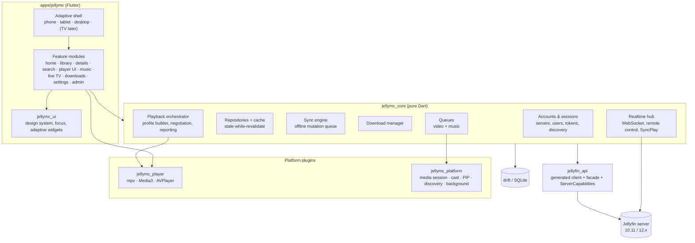

# Architecture

## Layers



Rules:

- **`jellymc_core` is pure Dart with no Flutter imports**, so it unit-tests in milliseconds and can run in background isolates (the download manager, sync).
- **Generated API types never leave `jellyfin_api`.** Core maps them to our own domain models. When the server spec changes, the blast radius is one package.
- **The UI talks to core through Riverpod providers only.** Features never call the API directly.
- **Native code sits behind Dart interfaces** that have fakes, so every feature can be tested without a device.

## Repository layout

```
apps/jellymc/                  Flutter app: one target for iOS, Android, Windows, macOS, Linux
  lib/shell/                   adaptive navigation, window chrome, routing
  lib/features/<feature>/      screens, view models (Riverpod), feature widgets
packages/
  jellyfin_api/                generated client (chopper) + JellyfinClient facade + ServerCapabilities
  jellymc_core/                domain models, repositories, sync, downloads, playback orchestration, queues
  jellymc_ui/                  tokens, theming, adaptive layout, focus traversal, shared widgets
  jellymc_player/              federated plugin: PlayerEngine interface + engine registry
  jellymc_player_mpv/          libmpv FFI + texture renderer (all platforms)
  jellymc_player_media3/       Android: Kotlin, Media3, SurfaceView platform view
  jellymc_player_avfoundation/ iOS/macOS: Swift, AVPlayer, AVPlayerLayer, PiP
  jellymc_platform/            media session, Cast, AirPlay route picker, PiP glue, UDP discovery, network monitor
tools/
  openapi/                     vendored spec(s) + regenerate script + diff report
  fixtures/                    docker-compose for Jellyfin 10.11 and 12.x, test-media generator
native-deps/                   pinned build scripts for libmpv/FFmpeg per platform (LGPL)
docs/
```

We use Dart pub workspaces for dependency resolution and `melos` for scripts (`melos run gen`, `melos run test`, `melos run fixtures:up`).

## Accounts, servers and sessions

- **Server identity** is the `Id` from `GET /System/Info/Public`, not the URL. One server record holds several addresses (LAN, WAN, reverse-proxy path) plus the last one that worked. On a network change we probe the LAN address first and fall back to the others.
- **Discovery:** broadcast `Who is JellyfinServer?` to UDP port 7359; servers reply with `{Address, Id, Name}`.
  - Android needs a `WifiManager.MulticastLock`.
  - **iOS needs the multicast networking entitlement** (`com.apple.developer.networking.multicast`), which Apple must approve, plus the local-network permission prompt. Apply for the entitlement early. Until it's granted, iOS falls back to manual URL entry and Quick Connect.
- **Auth:**
  - Every request carries `Authorization: MediaBrowser Client="jellymc", Device="<name>", DeviceId="<id>", Version="<ver>", Token="<token>"`.
  - URLs given to players and to the WebSocket carry `ApiKey=<token>`.
  - We never send `X-Emby-Token`, `api_key`, or `/emby` routes; 12.0 rejects them.
  - Logins: username/password (`/Users/AuthenticateByName`) and Quick Connect (`POST /QuickConnect/Initiate` → poll `/QuickConnect/Connect` → `/Users/AuthenticateWithQuickConnect`). Signed-in users can also *authorize* another device's code through `POST /QuickConnect/Authorize`.
- **DeviceId:** a random install id combined with the user id. The server ties sessions and tokens to the DeviceId, and sharing one id between two users on the same install risks one login revoking the other. *Verify the exact server behaviour in M0.*
- **Multi-server and multi-user:** any number of servers, each with any number of signed-in users. Switching is instant because each user's token stays in secure storage. A per-user PIN or biometric lock is a later feature.
- **SSO** (OIDC/SAML plugins): open the plugin's web flow in an in-app browser and capture the resulting token. This is plugin-specific; support the common OIDC plugin first.
- **Proxies and TLS:**
  - Per-server custom headers, for Cloudflare Access service tokens and auth proxies.
  - Optional client certificates.
  - Self-signed certificates through explicit trust-on-first-use pinning, never a global "ignore TLS" switch.
  - Base-path support (`https://host/jellyfin`).
- **`ServerCapabilities`:** computed once per connection from the server version and probes. Every version-conditional behaviour lives in this one class, never as scattered `if` statements. Examples: "has media segments", "legacy auth disabled", "sorting by `SortName`".

## Data: repositories, cache, sync

- **Cache model:**
  - `items` table: id, type, parent, sort keys, and indexed fields, with the full DTO stored as JSON.
  - `query_results`: a normalized query key mapped to an ordered list of ids, plus the fetch time and total count.
  - `user_data`: played, position, favorite and rating, per user and item.
- **Reads** use stale-while-revalidate: show the cached data immediately, refetch in the background, and diff the result into the UI.
- **Requests stay lean:**
  - Ask only for the fields each screen needs (`Fields=`).
  - Set `EnableImageTypes` and `ImageTypeLimit`.
  - Page with `StartIndex`/`Limit`.
  - Huge libraries (10k+ items) use windowed paging with an alphabet index.
- **Realtime invalidation:**
  - `LibraryChanged` evicts the affected parents' query results.
  - `UserDataChanged` patches `user_data` in place, so played ticks and favourites update across devices live.
- **Offline mutation queue:** played/unplayed, favourite, rating, playlist edits, and progress from offline playback. Each entry has a client timestamp and replays in order on reconnect.
  - Offline progress goes to `POST /UserItems/{id}/UserData` (`PlaybackPositionTicks`, `LastPlayedDate`).
  - Conflict rule: if the server's `LastPlayedDate` is newer, the server wins.
- **Roaming settings:** stored server-side in DisplayPreferences (`/DisplayPreferences/{id}?client=jellymc`, `CustomPrefs`), so the home layout, subtitle style and similar settings follow the user across devices. Device-specific settings stay local: engine choice, download location, bitrate on cellular.

## Downloads

- **A job is one item plus a quality.** It expands into files: the media itself, external subtitle streams, trickplay tiles, images, and JSON snapshots of chapters, media segments, lyrics and the item DTO. Everything needed to play and browse offline is on disk.
- **Original quality** comes from the static stream. **Transcoded quality** comes from a server progressive transcode with explicit container, codec and bitrate limits, falling back to segmented HLS download. *Spike S5 picks the mechanism.*
- **Rules:**
  - Wi-Fi only.
  - Storage cap.
  - Auto-download the next N unwatched episodes of a series.
  - Keep playlists and albums synced.
  - Delete after watched (with a delay).
  - Downloads resume across app restarts. iOS background transfers use `URLSession` background sessions; Android uses foreground-service workers.
- **The offline library view** reads only the local DB and files, and offline playback uses the same player screen.

## Realtime hub

- One WebSocket per active user session: `wss://<host>/socket?ApiKey=<token>&deviceId=<id>`.
  - Honour `ForceKeepAlive` by sending `KeepAlive` at half the interval.
  - Reconnect with jittered backoff.
  - Resubscribe on reconnect.
- **Dispatch table:**
  - `LibraryChanged` and `UserDataChanged` go to the cache.
  - `Play`, `Playstate` and `GeneralCommand` go to the remote-control handler: we are controllable.
  - `SyncPlayCommand` and `SyncPlayGroupUpdate` go to SyncPlay.
  - `ServerRestarting` and `ServerShuttingDown` show a banner.
  - `Sessions` feeds the "cast to device" picker.
- **We register as controllable** with `POST /Sessions/Capabilities/Full`: playable media types, supported `GeneralCommandType`s, `SupportsMediaControl`. jellyfin-web and other clients can then send media to us.

## Playback orchestrator

The orchestrator turns "play this item" into a running engine and keeps the server informed. Full design in [playback.md](playback.md). It owns:

- `DeviceProfileBuilder`: engine capabilities × runtime platform probes × user settings → `DeviceProfile`.
- `EngineSelector`: picks mpv, Media3 or AVPlayer per item, given the streams and the context (PiP, AirPlay, an active Cast session).
- `PlaybackSession`: the `PlaybackInfo` call, URL construction, track switching, the fallback chain, and progress reporting.
- `VideoQueue`: episodes, playlists, shuffle, and up-next autoplay.

## Music pipeline

Music is a separate, queue-centric pipeline. Video players make bad music players.

- **The queue model lives in Dart:** original order, shuffled order, repeat mode, "play next" vs "add to queue", and history. It's persisted, so the app restores the queue on restart.
- **Audio engine, v1:** `just_audio` + `audio_service`, both forked, which is Finamp's proven setup. Desktop uses mpv via `just_audio_media_kit`. Gapless comes from the engines' playlist sources.
  - If `audio_service` blocks Android Auto features, re-evaluate a native Media3 `MediaLibraryService`.
- **Streaming:** `GET /Audio/{id}/universal` with a container list, `MaxStreamingBitrate` and a transcoding container, using separate profiles for Wi-Fi and cellular. Original files are used when allowed.
- **Normalization:** apply `NormalizationGain` (track mode) or `AlbumNormalizationGain` (album mode). These are LUFS-based gains the server computes (10.9+). Volume ramps avoid clicks.
- **Lyrics:** `GET /Audio/{id}/Lyrics`. Lines have a `Start` in ticks and optional word-level `Cues`, which enables karaoke-style highlighting.
- **Car and OS integration:**
  - Android Auto: a browse tree through `audio_service`.
  - **CarPlay: a small native Swift module** using CPTemplates. This needs Apple's CarPlay audio entitlement, so apply early.
  - Lock screen, notification, Bluetooth and media keys: `audio_service`, MPRIS and SMTC.

## Platform services (Dart interfaces with native implementations)

| Service | Android | iOS | macOS | Windows | Linux |
|---|---|---|---|---|---|
| Media session / now playing | MediaSession | MPNowPlayingInfoCenter + MPRemoteCommandCenter | same as iOS | SMTC | MPRIS (D-Bus) |
| PiP | `enterPictureInPictureMode` | `AVPictureInPictureController` (AVPlayer; sample-buffer layer for mpv, which is a spike) | AVKit PiP / always-on-top mini window | Always-on-top mini window | Always-on-top mini window |
| Casting | Google Cast sender | Google Cast sender + AirPlay | AirPlay | (Jellyfin remote control) | (Jellyfin remote control) |
| Background work | WorkManager / foreground service | Background `URLSession`, audio background mode | always on | always on | always on |
| Discovery | UDP + multicast lock | UDP + multicast entitlement | UDP | UDP | UDP |
| Keep screen awake | `FLAG_KEEP_SCREEN_ON` | `isIdleTimerDisabled` | IOPMAssertion | `SetThreadExecutionState` | org.freedesktop.ScreenSaver inhibit |

## UI architecture

- **The adaptive shell** picks a layout by width class:
  - Compact (phone): bottom navigation.
  - Medium (tablet, small window): navigation rail.
  - Expanded (desktop, big tablet): sidebar, with a persistent mini-player.
- **Desktop affordances:** hover states, right-click context menus, multi-select, drag to playlist, keyboard shortcuts (mpv-like in the player), scroll-wheel volume, and window management (fullscreen, mini-player, always-on-top).
- **Touch:** swipe to seek, vertical swipes for brightness and volume, double-tap to skip ±10 s, pinch to zoom or fill.
- **Focus-first from day one.** Every interactive widget is focusable and works with arrow keys. That makes keyboard use pleasant now and makes the later TV/10-foot UI a layout job rather than a rewrite.
- **Theming:** light, dark and AMOLED; a dynamic accent colour drawn from artwork (on detail pages and the now-playing screen); and user-selectable density.
- **Accessibility:** semantics labels on all artwork cards, text scaling up to 200%, reduced motion, and screen-reader-friendly player controls.

## Errors, logging, observability

- **Typed failures:** `Network`, `AuthExpired` (which triggers a re-login sheet without losing navigation state), `ServerUnsupported`, `Forbidden` (parental policy), and `Playback(engine, code)`, which feeds the fallback chain.
- **Logs:** an in-memory ring buffer plus a rotating file, with tokens and `ApiKey` scrubbed, mpv logs included. "Send logs to server" uses `POST /ClientLog/Document`, so admins can see client problems in their own dashboard. No third-party telemetry unless the user opts in.

## Performance budgets

- Cold start to a cached home screen: **< 1.5 s** on a mid-range phone.
- Library grid scrolls at **60 fps** over 10k items: virtualized and paged, with images decoded at cell size.
- Time to first frame for a direct-play file on LAN: **< 1.5 s**. For a transcode, it depends on the server, and we show progress.
- The player screen never allocates per frame on the Dart side. Position updates are throttled to the UI's needs.
