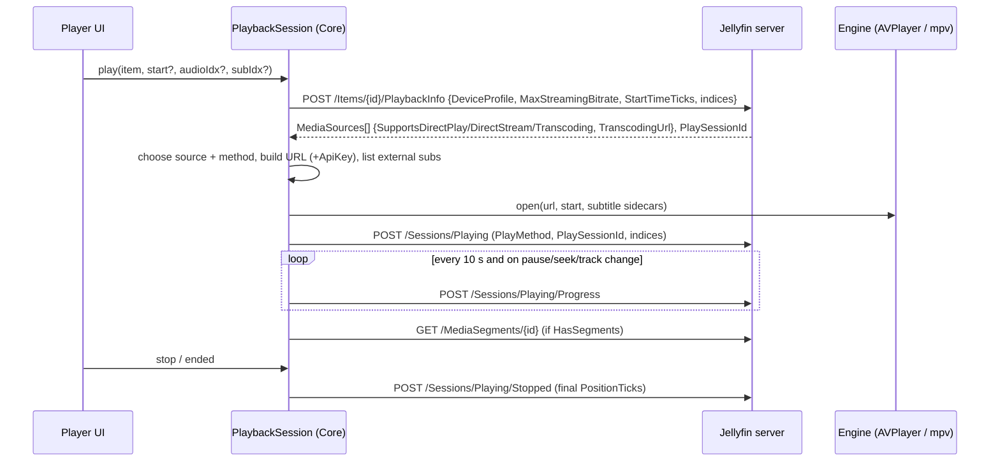

# Playback

Playback is the product. This doc covers the path from "tap Play" to "the server knows where you stopped": AVPlayer on iOS, libmpv on Linux. Endpoint names were checked against the 12.2 OpenAPI spec.

## End-to-end flow



## Engine interface

```swift
@MainActor
protocol PlayerEngine: AnyObject {
    var capabilities: EngineCapabilities { get }   // what goes into the DeviceProfile
    func open(_ source: PlaybackSource, at start: Double)
    func play()
    func pause()
    func seek(to seconds: Double)
    func setRate(_ rate: Double)
    func selectAudio(_ index: Int?)
    func selectSubtitle(_ index: Int?)
    var onEvent: ((PlayerEvent) -> Void)? { get set } // position, paused, buffering, tracks, ended, error
}
```

- **`AVPlayerEngine` (iOS):** `AVPlayer` in an `AVPlayerViewController`. PiP, AirPlay and Now Playing come from AVKit.
- **`MpvEngine` (Linux):** libmpv, rendered into a `GtkGLArea`. Later, an **HDR window mode** where mpv opens its own Wayland window with `vo=gpu-next` and `target-colorspace-hint=yes`, for real HDR on Plasma.

## How each platform plays an item

**Linux (mpv)** declares nearly everything as direct-playable, so the server sends the original file, and mpv handles the codec, subtitles and fonts.

**iOS (AVPlayer)** declares what AVPlayer really plays. The server then chooses:

1. **Direct play:** MP4/MOV/M4V with H.264/HEVC (AV1 on hardware that decodes it) and AAC/AC-3/E-AC-3/ALAC/FLAC/MP3.
2. **Direct stream:** the server remuxes MKV to HLS fMP4 and may transcode only the audio (TrueHD/DTS → E-AC-3). This is cheap, and keeps Dolby Vision/HDR10, PiP and AirPlay.
3. **Transcode:** only when the video itself can't be played, or when subtitles must be burned in (PGS, VobSub, or styled ASS when "keep ASS styling" is on).

Text subtitles reach AVPlayer as WebVTT inside the HLS stream. When the server has a GPU (the .148 box has an RTX 4070 Ti), transcodes are cheap, but direct stream is preferred so the original video reaches the phone.

An mpv engine for iOS (MPVKit) is a later milestone, for direct play of MKV with styled ASS on the phone.

## Device profiles

| | mpv (Linux) | AVPlayer (iOS) |
|---|---|---|
| Containers | mkv, mp4, m4v, mov, webm, ts, m2ts, avi, mpegts, ogg, flv, wmv/asf, … | mp4, m4v, mov; HLS (fMP4/TS) |
| Video | h264, hevc, vp9, av1, mpeg2video, vc1, mpeg4, vp8 (VA-API for h264/hevc/vp9/av1 on Arrow Lake) | h264, hevc; DV profiles 5/8 through HLS fMP4 |
| Audio | everything (decoded) | aac, ac3, eac3, alac, flac, mp3; TrueHD/DTS → server audio transcode |
| Subtitles | all: Embed/External | srt, vtt, (plain ass) → Hls; pgssub/dvdsub/styled ass → Encode |
| Transcoding target | HLS fMP4 HEVC/AAC (rarely used) | HLS fMP4: HEVC (all your Apple devices decode it in hardware), else H.264; AAC or E-AC-3 |

- **CodecProfiles** carry conditions on `VideoBitDepth`, `VideoRangeType`, `Width`/`Height` and `AudioChannels`.
- **mpv declares every HDR range type**, because it tone-maps for free. That keeps the server from spending GPU on server-side tone-mapping.
- **Settings feed into the profile:** max resolution, max bitrate (separately for LAN, remote and cellular), force transcode, and "keep ASS styling".
- **The profile builders are pure Swift in Core**, with tests that run on Linux.

## Source and URLs

- **Direct play:** `/Videos/{id}/stream?static=true&MediaSourceId=…&PlaySessionId=…&ApiKey=…`.
- **Direct stream / transcode:** the server's `TranscodingUrl`. Append `ApiKey` if it's missing. Never hand-build HLS URLs; those routes aren't in the published spec.
- **Music:** `/Audio/{id}/universal`.
- **Versions:** an item can have several `MediaSources` (4K and 1080p). The user picks one, and the choice is remembered per series.

## Subtitles

- **mpv:** all formats. Embedded MKV fonts work with direct play. External subtitle streams come from `/Videos/{id}/{mediaSourceId}/Subtitles/{index}/Stream.{format}` and are added with `sub-add`.
- **AVPlayer:** WebVTT through HLS. Anything image-based or styled gets burned in by the server, chosen in the profile.
- **Default track:** language rules per audio language (for example "Japanese audio → English subs; English audio → forced only"), then forced flags, then `DefaultSubtitleStreamIndex`.

## HDR and Dolby Vision

| Source | Linux mpv in-window | Linux mpv HDR window (later) | iOS AVPlayer |
|---|---|---|---|
| HDR10 / HDR10+ | Tone-map (libplacebo) | HDR passthrough on Plasma HDR | HDR (EDR) |
| HLG | Tone-map | HDR | HDR |
| DV profile 5 | Tone-map with DV reshaping | HDR | **Dolby Vision** (HLS fMP4 remux) |
| DV profile 7 | Base layer, tone-mapped | HDR10 base layer | HDR10 base layer through remux |
| DV profile 8.1 / 8.4 | Tone-map | HDR | **Dolby Vision** |

## Reporting

- **`POST /Sessions/Playing`** on start, with `ItemId`, `MediaSourceId`, `PlaySessionId`, `PlayMethod`, `AudioStreamIndex`, `SubtitleStreamIndex`, `PositionTicks` and `CanSeek`.
- **`POST /Sessions/Playing/Progress`** every 10 s, and immediately on pause, resume, seek and track change.
- **`POST /Sessions/Playing/Stopped`** with the final position. The server decides played vs resume from its own thresholds.
  - On iOS, also send it when the app goes to the background without PiP, or when the player closes.
- **`POST /Sessions/Playing/Ping`** during long pauses of transcodes.
- **Offline playback** writes progress to the outbox.

## Track switching and seeking

- **Direct play:** switch inside the engine (mpv `aid`/`sid`; AVPlayer `AVMediaSelectionGroup`).
- **Direct stream / transcode:** call `PlaybackInfo` again with the new indices at the current position, swap the source, and stop the old `PlaySessionId`.
- **Seeking in transcodes** restarts the encode server-side. Debounce scrubbing.

## Skip, chapters, trickplay, up next

- **Media segments:** `GET /MediaSegments/{itemId}` returns Intro, Outro, Recap, Preview and Commercial ranges.
  - Each type can be set to Ask (show a Skip button), Auto-skip, or Ignore.
  - Defaults: Intro/Recap/Preview = Ask, Commercial = Auto-skip, Outro = start "Up next".
- **Up next:** begins at the Outro segment, or 30 s before the end if there's none. A 10 s countdown shows the next episode from `/Shows/NextUp`.
- **Chapters:** shown as a chapter list. mpv also gets the chapters natively.
- **Trickplay:** `item.Trickplay[mediaSourceId][width]` gives `{TileWidth, TileHeight, Interval, ThumbnailCount}`. The tile image index is `floor(t / Interval / (TileWidth × TileHeight))`, fetched from `/Videos/{id}/Trickplay/{width}/{index}.jpg`.

## Fallback chain

1. The engine fails. Retry with `PlaybackInfo` set to `EnableDirectPlay=false`, forcing a remux or transcode.
2. Still failing: transcode H.264 SDR + AAC stereo at a lower bitrate.
3. Then show the error with the reason, a log excerpt, and "send logs to server".

The **stats overlay** (Diagnostics) shows the play method, `TranscodeReasons` (from the `TranscodingUrl`), codecs, resolution and bitrate.

## Testing playback

- **Core tests (Linux and CI):** profile builders, the source and method decision, URL building, ticks conversion, segment lookup, the trickplay tile maths, and DTO decoding from recorded 12.2 responses.
- **Test server** (`tools/testserver`) holds FFmpeg-generated media:
  - H.264/AAC MP4 with sidecar SRT
  - HEVC 10-bit MKV with styled ASS and chapters
  - an AC-3 5.1 MKV with PGS-like (dvdsub) subtitles
  - a three-episode series
  - a FLAC album

  Each fixture is played on Linux, and on the iPhone for each play method.
