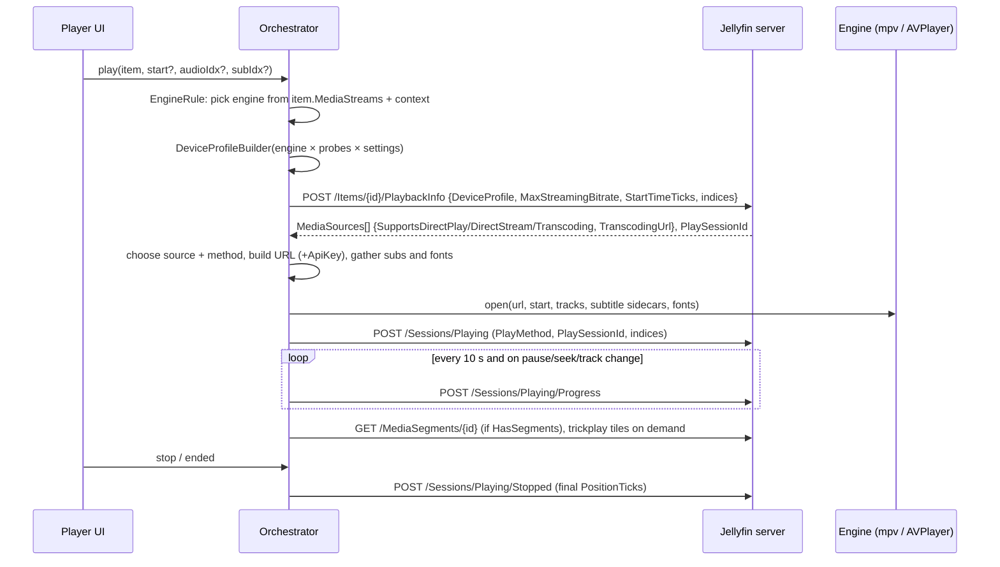

# Playback

Playback is the product. This doc covers the path from "tap Play" to "the server knows where you stopped", with mpv on Linux and iOS and AVPlayer on iOS. Endpoint names were checked against the 12.2 OpenAPI spec.

## End-to-end flow



## Engine interface

```dart
abstract interface class PlayerEngine {
  EngineId get id;
  EngineCapabilities get capabilities; // containers, codecs, subtitle formats, hdrOutput, pip, airplay
  Future<void> open(PlaybackSource source, {Duration start = Duration.zero});
  Future<void> play();
  Future<void> pause();
  Future<void> seek(Duration position);
  Future<void> setRate(double rate);
  Future<void> selectAudio(TrackRef? track);
  Future<void> selectSubtitle(TrackRef? track);
  Future<void> addExternalSubtitle(Uri uri, {String? language, String? title});
  Stream<PlayerEvent> get events; // position, buffering, tracks, videoSize, hdrState, error, ended
  Widget buildView(); // Texture for in-app mpv; platform view for AVPlayer; placeholder for the mpv HDR window
  Future<void> dispose();
}
```

Engines:

- `MpvEngine` (Linux and iOS): media_kit's libmpv, vendored.
  - Linux has an extra **HDR window mode**: no render API. mpv creates its own Wayland toplevel with `vo=gpu-next` and `target-colorspace-hint=yes`, using mpv's on-screen controller. Our app keeps the session, reporting, queue and up-next logic, and drives mpv through the same interface.
- `AvPlayerEngine` (iOS): wraps the AVPlayer plugin chosen in spike S3.

`PlatformProbe` adds runtime facts on top of each engine's static `EngineCapabilities`:

- **Hardware decoders:** `VTIsHardwareDecodeSupported` on iOS, which matters for AV1 (A17 Pro/M-series and newer). VA-API profiles on Linux.
- **Display:** HDR/EDR headroom on iOS. Whether Plasma HDR is on, on Linux.
- **Audio route:** headphones, AirPods (spatial), AirPlay, HDMI.

## Engine selection

**Linux:**

1. If the source is HDR, the "HDR output" setting is on, and the Plasma output is in HDR mode, use **mpv HDR window mode**.
2. Otherwise use **mpv in-app** (tone-mapped if the source is HDR).

**iPhone / iPad:**

1. If an AirPlay video route is active, use **AVPlayer**.
2. If AVPlayer can play the item **without re-encoding the video and without burning in subtitles**, use **AVPlayer**. That covers:
   - direct play of MP4/MOV/M4V
   - direct stream: the server remuxes MKV to HLS fMP4, and may transcode only the audio, for example TrueHD → E-AC-3

   Subtitles must be none or plain text (served as WebVTT through HLS). This is the iOS default because it gives PiP, AirPlay, Dolby Vision/HDR, AirPods spatial audio, and the best battery life.
3. If the item has **styled ASS** (and "keep ASS styling" is on, the default), **PGS/VobSub**, or anything else AVPlayer can't take, use **mpv**, with direct play and full fidelity.
   - PiP isn't available on mpv. The player shows a hint with a "play with AVPlayer instead" option, where the server burns in the subtitles.
4. If neither can play it without a video transcode, **transcode through AVPlayer** (HLS).

**Overrides:** global ("always mpv" or "always AVPlayer") and per series, remembered. Offline: transcoded downloads (MP4) go to AVPlayer; original MKV downloads go to mpv.

**Examples:**

- **HEVC 10-bit MKV with styled ASS (typical anime) on iPhone:** mpv, direct play.
- **Dolby Vision P8.1 MKV with SRT on iPhone:** AVPlayer, through a server remux to HLS fMP4 with WebVTT. You get DV on the OLED display and PiP.
- **4K HDR10 HEVC on Linux with Plasma HDR on:** mpv HDR window. With HDR off, mpv in-app, tone-mapped.

## Device profile builder

Output: a `DeviceProfile` with `DirectPlayProfiles`, `TranscodingProfiles`, `CodecProfiles`, `SubtitleProfiles` and `ContainerProfiles`, plus `MaxStreamingBitrate`, `MaxStaticBitrate` and `MusicStreamingTranscodingBitrate`.

| | mpv (Linux) | mpv (iOS) | AVPlayer (iOS) |
|---|---|---|---|
| Containers | Effectively everything FFmpeg reads: mkv, mp4, mov, webm, ts/m2ts, avi, … | same | mp4, m4v, mov; HLS (fMP4) |
| Video | h264, hevc (8/10-bit), vp9, av1 via VA-API on Arrow Lake; mpeg2, vc1, mpeg4 in software | h264, hevc via VideoToolbox; av1 via hardware where available, else dav1d up to a resolution cap; the rest in software | h264, hevc; av1 only where `VTIsHardwareDecodeSupported`; DV profiles 5 and 8 |
| Audio | everything (decoded); passthrough optional (HDMI) | everything (decoded) | aac, ac3, eac3 (+ Atmos JOC), alac, flac, mp3. TrueHD and DTS go to a server audio transcode. |
| Subtitles | all, Embed/External | all, Embed/External | text → Hls (WebVTT); styled ASS/PGS/VobSub → Encode (burn-in) |

- **CodecProfiles** carry conditions on `VideoProfile`, `VideoLevel`, `VideoBitDepth`, `VideoRangeType`, `RefFrames`, `Width`/`Height`, `VideoFramerate` and `AudioChannels`.
  - **Declare the HDR range types mpv can tone-map**, so the server never spends its GPU on tone-mapping that the client can do for free.
- **TranscodingProfiles:** HLS fMP4, HEVC (all your Apple devices and the Linux iGPU decode it in hardware) with H.264 as fallback. Audio is AAC, or E-AC-3 when the route can use it. Music has its own profile (AAC or Opus at the configured bitrate).
- **Settings inputs:** max resolution, bitrate for LAN, remote and cellular, force transcode, "keep ASS styling", max audio channels, Linux HDMI passthrough.
- **Auto bitrate when remote:** measure with `GET /Playback/BitrateTest?size=` on connect and after network changes, and use 80% of the result.
- **Unit-tested:** the builder is pure Dart, with snapshot tests per (engine, probe fixture), and runs on Linux CI.

## Choosing the source and building URLs

- **Versions:** an item can have several `MediaSources`, for example 4K and 1080p. Remember the choice per series. On cellular, default to the smaller version.
- **URLs by method:**
  - **Direct play:** `/Videos/{id}/stream?static=true&MediaSourceId=…&PlaySessionId=…&ApiKey=…`.
  - **Direct stream / transcode:** the server's `TranscodingUrl`. Append `ApiKey` if it's missing. Never hand-build HLS URLs; those routes aren't in the published spec.
  - **Music:** `/Audio/{id}/universal`.
- **Headers:** mpv takes `http-header-fields`. AVPlayer gets auth through the query string. Forward a MediaSource's `RequiredHttpHeaders` to the engine.
- **Live TV** (M5, only if you have tuners): call `PlaybackInfo` with `AutoOpenLiveStream=true`. If the MediaSource says `RequiresClosing`, call `POST /LiveStreams/Close` with its `LiveStreamId` on stop.

## Subtitles

| Format | mpv | AVPlayer |
|---|---|---|
| SRT / SubRip, WebVTT | Embed / External | Hls (WebVTT) |
| ASS / SSA | **Embed / External, full libass styling** | Hls as plain text (styling lost; only when "keep ASS styling" is off), else Encode |
| PGS, VobSub, DVB | Embed | Encode (burn-in) |

- **Fonts for ASS:** direct play of an MKV brings its font attachments. For external or HLS delivery, fetch attachments from `/Videos/{videoId}/{mediaSourceId}/Attachments/{index}` and the server's fallback fonts (`/FallbackFont/Fonts`), then set mpv's `sub-fonts-dir`. Downloads keep the fonts too.
- **External subtitle streams:** `/Videos/{id}/{mediaSourceId}/Subtitles/{index}/Stream.{format}`, with a start-ticks variant for mid-file transcodes.
- **Default track rules** use your language preferences per audio language, for example "Japanese audio → English subs; English audio → none (forced only)". Then forced flags, then the server's `DefaultSubtitleStreamIndex`.
- **Styling:** size, colour, outline, background, vertical position, and "override ASS styles" (mpv `sub-ass-override`). It roams between devices through DisplayPreferences. The AVPlayer engine applies what it can through text-style rules.

## HDR and Dolby Vision

| Source | Linux, mpv in-app | Linux, mpv HDR window (Plasma HDR on) | iOS, AVPlayer | iOS, mpv |
|---|---|---|---|---|
| HDR10 / HDR10+ | Tone-map (libplacebo) | HDR passthrough | HDR (EDR) | Tone-map |
| HLG | Tone-map | HDR | HDR | Tone-map |
| DV profile 5 | Tone-map (libplacebo DV reshaping) | HDR via libplacebo | **Dolby Vision** (through an HLS fMP4 remux; verify in S3) | Tone-map |
| DV profile 7 (Blu-ray dual-layer) | Base layer, tone-mapped | HDR10 base layer | HDR10 base layer through remux | Tone-map |
| DV profile 8.1 / 8.4 | Tone-map | HDR | **Dolby Vision** | Tone-map |

- **Use `VideoRangeType`** (`HDR10`, `HDR10Plus`, `HLG`, `DOVI`, `DOVIWithHDR10`, `DOVIWithEL`, …) from the media streams for engine choice and in `CodecProfiles` conditions.
- **Promise:** every HDR title plays with correct colours on both platforms without server-side tone-mapping. It's true HDR on the iPhone through AVPlayer, and on Linux through the HDR window.

## Audio

- **iOS:**
  - AVPlayer passes E-AC-3 JOC (Atmos) to AirPods spatial audio and AirPlay.
  - TrueHD and DTS sources go through a server audio-only transcode (cheap), or through mpv decoding to PCM when mpv is the engine.
  - The audio session uses the `.playback` category with the `moviePlayback` mode.
- **Linux:** decode to PipeWire and downmix to the sink's channel count. An HDMI passthrough option (`audio-spdif=ac3,eac3,dts,dts-hd,truehd`) is available for an AV receiver.
- **Speed:** 0.5×–3× with pitch correction.

## Track switching and seeking

- **Direct play:** switch in the engine. That's instant, and a progress report is the only server call.
- **Direct stream / transcode:** call `PlaybackInfo` again with the new `AudioStreamIndex`/`SubtitleStreamIndex` at the current position, then swap the source. The old session ends with `Stopped` for the old `PlaySessionId`.
- **Seeking:** in transcodes, seeking past the transcoded range restarts the encode. Debounce scrubbing to the final position and show buffering.

## Reporting

- **`POST /Sessions/Playing`** on start, with `ItemId`, `MediaSourceId`, `PlaySessionId`, `PlayMethod`, `AudioStreamIndex`, `SubtitleStreamIndex`, `PositionTicks`, `CanSeek` and `NowPlayingQueue`.
- **`POST /Sessions/Playing/Progress`** every 10 s, and immediately on pause, resume, seek, track change, rate change and volume change. It includes `IsPaused`, `RepeatMode` and `PlaybackOrder`.
- **`POST /Sessions/Playing/Stopped`** with the final position. The server decides "played" vs "resume point" from its thresholds.
  - **On iOS, also send it when the app is backgrounded or terminated during playback.** Otherwise a swiped-away app leaves a stale session.
- **`POST /Sessions/Playing/Ping`** during long pauses of transcodes.
- **Offline playback** writes progress to the sync queue (see [architecture.md](architecture.md#data-repositories-cache-sync)).

## Skip, chapters, trickplay, up next

- **Media segments:** if `MediaSource.HasSegments`, fetch `GET /MediaSegments/{itemId}`. The types are Intro, Outro, Recap, Preview, Commercial and Unknown.
  - A per-type setting chooses **Ask** (a Skip button during the segment), **Auto-skip**, or **Ignore**.
  - Defaults: Intro/Recap/Preview = Ask, Commercial = Auto-skip, Outro = start "Up next".
  - Segments come from server plugins such as Intro Skipper.
- **Up next:** begins at the Outro segment, or at runtime minus 30 s if there's no Outro. A countdown card (10 s by default) shows the next item from `/Shows/NextUp` or from the queue. "Still watching?" appears after 3 autoplays without input.
- **Chapters:** seekbar markers plus a chapter list with images (`/Items/{id}/Images/Chapter/{index}`), and next/previous chapter controls and keys.
- **Trickplay:** `item.Trickplay[mediaSourceId]` maps widths to `{TileWidth, TileHeight, Interval, ThumbnailCount}`.
  - Pick the width nearest the display target.
  - The tile image index is `floor(t / Interval / (TileWidth × TileHeight))`.
  - Fetch `/Videos/{id}/Trickplay/{width}/{index}.jpg`, preloading neighbouring tiles. Downloads include one width.

## Fallback chain

1. The engine fails to open or decode. On iOS, retry once with the other engine if it can play without a video transcode.
2. Still failing: call `PlaybackInfo` again with `EnableDirectPlay=false`, forcing a remux or transcode.
3. Still failing: transcode to the most compatible profile (H.264 SDR + AAC stereo) at a lower bitrate.
4. Then show an error with the reason, a log excerpt, and "Send logs to server".

**The stats overlay** shows the engine, play method, the server's `TranscodeReasons` (from the `TranscodingUrl`), codecs, resolution, HDR state, bitrate, buffer, and dropped frames. It's the first stop when debugging, especially on the iPhone, where there's no debugger.

## Testing playback against your own library

A synthetic codec matrix would mostly test things you don't own. Test what's actually on your server instead.

- **Library census** (`just census`, a Dart CLI in `tools/census/`):
  1. Pages through `/Items?Recursive=true&IncludeItemTypes=Movie,Episode,Video,MusicVideo&Fields=MediaSources,MediaStreams`.
  2. Buckets every media source by (container, video codec, profile and bit depth, `VideoRangeType`, audio codec and channels, subtitle codecs).
  3. Writes `tools/census/report.md` with counts and one sample item per bucket.
- **The playback checklist is generated from the census:** the buckets covering about 99% of items, plus every HDR/DV and every image-subtitle bucket. Each one is run on Linux (in-app, and the HDR window where relevant) and on the iPhone (the engine the rule picks, plus a forced other engine). The expected play method and pass/fail go into `tools/census/checklist.md`, which is re-run before every "release".
- **CI smoke tests on Linux:** a handful of FFmpeg-generated clips in `tools/fixtures/` (H.264/AAC MP4, HEVC 10-bit MKV with ASS, AV1, PGS). The mpv engine must open each one, play 2 s, seek, and switch tracks.
