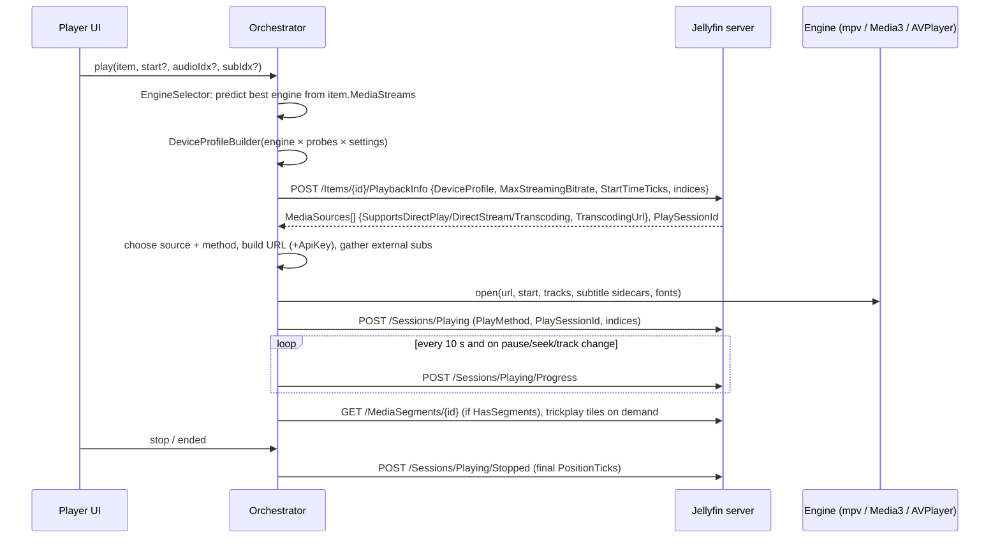

# Playback

Playback is the product. This doc covers the path from "user taps Play" to "server knows where they stopped". Endpoint names were checked against the 12.2 OpenAPI spec.

## End-to-end flow



## Engine interface

```dart
abstract interface class PlayerEngine {
  EngineId get id;
  EngineCapabilities get capabilities; // containers, codecs, subtitle formats, hdrOutput, pip, airplay, passthrough
  Future<void> open(PlaybackSource source, {Duration start = Duration.zero});
  Future<void> play();
  Future<void> pause();
  Future<void> seek(Duration position);
  Future<void> setRate(double rate);
  Future<void> selectAudio(TrackRef? track);
  Future<void> selectSubtitle(TrackRef? track);
  Future<void> addExternalSubtitle(Uri uri, {String? language, String? title});
  Stream<PlayerEvent> get events; // position, buffering, tracks, videoSize, hdrState, error, ended
  Widget buildView(); // Texture for mpv; platform view for Media3/AVPlayer
  Future<void> dispose();
}
```

`EngineCapabilities` is static per engine and platform. `PlatformProbe` adds what this device can do at runtime:

- **Decoders:** `MediaCodecList` on Android, `VTIsHardwareDecodeSupported` on Apple, the mpv hwdec probe on desktop.
- **Display:** HDR support.
- **Audio route:** channel count, passthrough encodings (Android `AudioCapabilities`; a user setting on desktop).

## Engine selection

For each engine available on this platform, predict the outcome *locally* from `item.MediaSources[].MediaStreams` and the selected tracks:

```
predict(engine) -> { method: DirectPlay | DirectStream | Transcode,
                     hdrPreserved: bool, subtitleFidelity: full | basic | burnIn }

score = { DirectPlay: 100, DirectStream: 60, Transcode: 0 }[method]
      + (source is HDR && display is HDR && hdrPreserved ? 30 : 0)
      + { full: 20, basic: 10, burnIn: 0 }[subtitleFidelity]
      + context bonuses (AirPlay route active → AVPlayer +100;
                         iOS PiP-on-background enabled → AVPlayer +40, unless the mpv PiP spike succeeds;
                         Cast session active → hand off to Cast instead)
```

- The highest score wins.
- Ties go to the platform default: **Android → Media3**, **iOS → decided by spike S3**, **desktop → mpv**.
- A user override, global or per item ("always use mpv"), beats the score.
- We then call `PlaybackInfo` **once**, with the winner's profile, and trust the server's verdict.

Examples:

- **HEVC 10-bit MKV with styled ASS on Android.** Media3 direct-plays but with basic ASS (110). mpv direct-plays with full ASS (120). **mpv wins.**
- **Dolby Vision P8.1 MP4 with SRT, on Android with an HDR display.** Media3 scores 100 + 30 + 20 = 150; mpv tone-maps, so 120. **Media3 wins.**
- **MKV H.264 with PGS on iOS.** mpv: DirectPlay with full subtitles (120). AVPlayer: DirectStream (HLS remux) with PGS burned in, which is really a transcode (0). **mpv wins.**

## Device profile builder

Output: a `DeviceProfile` with `DirectPlayProfiles`, `TranscodingProfiles`, `CodecProfiles`, `SubtitleProfiles` and `ContainerProfiles`, plus `MaxStreamingBitrate`, `MaxStaticBitrate` and `MusicStreamingTranscodingBitrate`.

- **DirectPlayProfiles:** per engine, the containers and codecs it can play, intersected with the probed hardware decoders. Software-decoded codecs (for example AV1 through dav1d on older phones) are allowed up to a resolution cap.
- **CodecProfiles** carry conditions on `VideoProfile`, `VideoLevel`, `VideoBitDepth`, `VideoRangeType`, `RefFrames`, `Width`/`Height`, `VideoFramerate` and `AudioChannels`.
  - **Declare HDR range types the engine can tone-map**, so the server doesn't spend GPU on server-side tone-mapping when the client could do it for free.
- **TranscodingProfiles:**
  - Video: HLS with fMP4 segments, HEVC if the device has a hardware HEVC decoder, else H.264. Audio: AAC, plus AC-3/E-AC-3 if passthrough is available.
  - Music: a separate profile (Opus or AAC at the configured bitrate).
- **SubtitleProfiles:** see the matrix below.
- **Settings inputs:** max resolution; bitrate for Wi-Fi, cellular and remote; "allow HEVC/AV1"; force transcode; audio passthrough on/off; max audio channels.
- **Auto bitrate for remote connections:** measure with `GET /Playback/BitrateTest?size=`, and use 80% of the result as `MaxStreamingBitrate`.
- **Unit-tested:** the builder is pure Dart, with snapshot tests of the generated profile for every (platform, engine, probe fixture) combination.

## Choosing the source and building URLs

- **Versions:** an item can have several `MediaSources`, for example 4K and 1080p. Remember the user's choice per series.
- **URLs by method:**
  - **Direct play:** `/Videos/{id}/stream?static=true&MediaSourceId=…&PlaySessionId=…&ApiKey=…`.
  - **Direct stream / transcode:** the server's `TranscodingUrl`. Append `ApiKey` if it's missing. Don't hand-build HLS URLs; the dynamic HLS routes aren't in the published spec.
  - **Music:** `/Audio/{id}/universal`.
- **Headers to engines:** mpv takes `http-header-fields`, and Media3 takes `DataSource` headers. AVPlayer header injection isn't public API, so query-string auth is the portable path.
- **`RequiredHttpHeaders` on a MediaSource** must be forwarded to the engine.
- **Live TV:** call `PlaybackInfo` with `AutoOpenLiveStream=true`. If the MediaSource says `RequiresClosing`, call `POST /LiveStreams/Close` with its `LiveStreamId` on stop.

## Subtitles

| Format | mpv | Media3 | AVPlayer |
|---|---|---|---|
| SRT / SubRip | Embed / External | Embed / External | **Hls** (server serves WebVTT) |
| WebVTT | Embed / External | Embed / External | Hls |
| ASS / SSA | **Embed / External, full libass styling** | External (basic styling); Encode for full fidelity | **Encode** (burn-in) |
| PGS | Embed | Embed | Encode |
| VobSub / DVB | Embed | Embed (verify per format) | Encode |

- **Fonts for ASS:** embedded MKV attachments come with direct play. For external or HLS delivery, fetch attachments from `/Videos/{videoId}/{mediaSourceId}/Attachments/{index}`, plus the server-configured fallback fonts (`/FallbackFont/Fonts`), and point mpv's `sub-fonts-dir` at them.
- **External subtitle streams:** `/Videos/{id}/{mediaSourceId}/Subtitles/{index}/Stream.{format}`, with a start-ticks variant for transcodes that start mid-file.
- **Choosing a default track:**
  1. The user's default language per audio language. Example: "English audio → no subs; Japanese audio → English subs".
  2. Then forced tracks.
  3. Then the server's `DefaultSubtitleStreamIndex`.
- **Styling:** text size, colour, outline, background, position, and "override ASS styles" (mpv `sub-ass-override`). These roam through DisplayPreferences.
- **Online subtitle search** (`/Items/{id}/RemoteSearch/Subtitles/{language}`) is exposed when the server has a subtitle provider plugin.

## HDR and Dolby Vision

| Source | Desktop (mpv, texture) | Android, Media3 | Android, mpv | iOS/macOS, AVPlayer | iOS, mpv |
|---|---|---|---|---|---|
| HDR10 / HDR10+ | Tone-map with libplacebo (v1). Passthrough through a native window later | HDR output if display supports it | Tone-map | HDR via HLS fMP4 remux | Tone-map |
| HLG | Tone-map | HDR | Tone-map | HDR | Tone-map |
| DV profile 5 | Tone-map (libplacebo handles DV reshaping) | DV if the device has a DV decoder, else mpv | Tone-map | DV on supported hardware | Tone-map |
| DV profile 7 (Blu-ray dual-layer) | Base layer → tone-map | HDR10 base layer. P7→P8.1 conversion is a later stretch goal | Tone-map | HDR10 base layer through remux | Tone-map |
| DV profile 8.1 / 8.4 | HDR10/HLG base → tone-map | DV or HDR10 | Tone-map | DV | Tone-map |

- **Use `VideoRangeType`** (`HDR10`, `HDR10Plus`, `HLG`, `DOVI`, `DOVIWithHDR10`, `DOVIWithEL`, …) from the media streams both for engine prediction and in `CodecProfiles` conditions.
- **1.0 promise:** every HDR title plays with correct colours everywhere (tone-mapped or real HDR), without server-side tone-mapping.
- **Post-1.0:** true HDR output on desktop.

## Audio

- **Passthrough:**
  - Desktop mpv: `audio-spdif=ac3,eac3,dts,dts-hd,truehd` when the user enables a receiver. The profile then declares those codecs with up to 8 channels.
  - Android: Media3 with the encodings reported by `AudioCapabilities` over HDMI or ARC.
  - Apple: AVPlayer for E-AC-3 JOC (Atmos) to AirPlay/HDMI. Other formats are decoded to multichannel PCM.
- **Downmix** to the route's channel count, so headphones mean stereo. A "night mode" (dynamic range compression, through mpv filters) comes later.
- Playback speed from 0.5× to 3× with pitch correction, mainly for audiobooks and lectures.

## Track switching and seeking

- **Direct play:** switch tracks inside the engine. That's instant, and no server call is needed beyond a progress report.
- **Direct stream / transcode:** call `PlaybackInfo` again with the new `AudioStreamIndex`/`SubtitleStreamIndex` at the current position, then swap the engine source. The old transcode ends with `Stopped` for the old `PlaySessionId`.
- **Seeking:** in HLS transcodes, seeking beyond the transcoded range restarts the transcode server-side. Show buffering, and don't spam seeks; debounce scrubbing to the final position.

## Reporting

- **`POST /Sessions/Playing`** on start, with `ItemId`, `MediaSourceId`, `PlaySessionId`, `PlayMethod`, `AudioStreamIndex`, `SubtitleStreamIndex`, `PositionTicks`, `CanSeek` and `NowPlayingQueue`.
- **`POST /Sessions/Playing/Progress`** every 10 s while playing, and immediately on pause, resume, seek, track change, rate change and volume change. It includes `IsPaused`, `RepeatMode` and `PlaybackOrder`.
- **`POST /Sessions/Playing/Stopped`** with the final position. The server decides "played" vs "resume point" based on its configured thresholds, so we don't duplicate that logic.
- **`POST /Sessions/Playing/Ping`** with the `PlaySessionId` during long pauses of transcodes, so the server doesn't kill the encode.
- **Offline playback** writes progress to the sync queue (see [architecture.md](architecture.md#data-repositories-cache-sync)).

## Skip, chapters, trickplay, up next

- **Media segments:** if `MediaSource.HasSegments`, fetch `GET /MediaSegments/{itemId}`. The types are Intro, Outro, Recap, Preview, Commercial and Unknown. A per-type setting chooses **Ask** (a Skip button visible during the segment), **Auto-skip**, or **Ignore**.
  - Defaults: Intro/Recap/Preview = Ask, Commercial = Auto-skip, Outro = start "Up next".
  - Segments come from server plugins such as Intro Skipper. We need nothing plugin-specific.
- **Up next:** begins at the Outro segment, or at runtime minus 30 s if there's no Outro. A countdown card (10 s by default) shows the next item from `/Shows/NextUp` or from the queue. "Are you still watching?" appears after 3 consecutive autoplays without input (configurable).
- **Chapters:** seekbar markers plus a chapter list with images (`/Items/{id}/Images/Chapter/{index}`), and next/previous chapter shortcuts.
- **Trickplay:** `item.Trickplay[mediaSourceId]` maps widths to `{TileWidth, TileHeight, Interval, ThumbnailCount}`.
  - Pick the width nearest the display target.
  - The tile image index is `floor(t / Interval / (TileWidth × TileHeight))`.
  - Fetch `/Videos/{id}/Trickplay/{width}/{index}.jpg`, preloading neighbouring tiles. Downloads include one width.

## Fallback chain

1. The engine fails to open or decode. If another engine predicts DirectPlay or DirectStream, retry once with it.
2. Still failing: call `PlaybackInfo` again with `EnableDirectPlay=false`, forcing a remux or transcode.
3. Still failing: transcode to the most compatible profile (H.264 SDR + AAC stereo) at a lower bitrate.
4. Then show a clear error, with the reason, the engine log excerpt, and "Send logs to server" (`/ClientLog/Document`).

**Every step is visible in the playback info overlay** (stats for nerds): engine, play method, the server's `TranscodeReasons` (taken from the `TranscodingUrl`), codecs, resolution, HDR state, bitrate, buffer, and dropped frames. This is also the most useful bug-report artifact we can get.

## Conformance suite

A fixture library runs against every engine on every platform. The expected play method and a pass/fail result for each cell are committed as a matrix (`tools/fixtures/matrix.md`), and CI flags regressions.

- **Containers:** MKV, MP4, MOV, WebM, MPEG-TS/M2TS, AVI.
- **Video:** H.264 (High, High10, interlaced), HEVC Main/Main10, AV1 10-bit, VP9 profile 2, MPEG-2, VC-1.
- **HDR:** HDR10, HDR10+, HLG, DV P5, P7 (FEL and MEL), P8.1, P8.4.
- **Audio:** AAC LC/HE, MP3, Opus, Vorbis, FLAC 24/96, ALAC, AC-3 5.1, E-AC-3 + JOC, DTS, DTS-HD MA, TrueHD (+ Atmos), multichannel PCM.
- **Subtitles:** SRT, WebVTT, styled ASS with attached fonts, PGS, VobSub, DVB, sidecar files, forced flags, multiple languages.
- **Edge cases:** multiple versions, multi-part files (`/Videos/{id}/AdditionalParts`), anamorphic video, rotation metadata, variable frame rate, 100 Mbps UHD remux, files over 3 hours, missing duration, Live TV stream.

Most fixtures can be generated with FFmpeg in `tools/fixtures/`. Dolby Vision and Atmos samples need redistributable sources, so collect them in M0.
